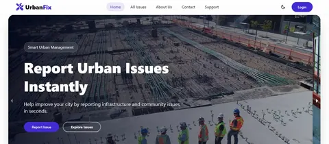

# Mehedi Robi — MERN Stack Developer

A responsive portfolio featuring selected full-stack projects, technical skills, education, and contact information.

**Live portfolio:** [mehedirobi-portfolio.netlify.app](https://mehedirobi-portfolio.netlify.app/)

## Featured projects

### Khelaro

A sports turf booking platform for discovering venues, checking availability, and managing bookings.


[Live demo](https://khelaro-project.netlify.app/) · [Client code](https://github.com/mehedirobi/khelaro) · [Server code](https://github.com/mehedirobi/khelaro-server)

### UrbanFix

A civic issue reporting platform with authentication, role-based dashboards, and issue tracking workflows.



[Live demo](https://urbanfix-project-01.netlify.app/) · [Client code](https://github.com/mehedirobi/urbanfix) · [Server code](https://github.com/mehedirobi/urbanfix-server)

### PawMart

A pet adoption and supplies platform with category-based browsing, listing management, and order workflows.


[Live demo](https://pawmart-project-01.netlify.app/) · [Client code](https://github.com/mehedirobi/pawmart) · [Server code](https://github.com/mehedirobi/pawmart-server)

## Built with

React 18, JavaScript, Vite, Tailwind CSS, Framer Motion, and React Icons.

## Run locally

```bash
npm install
npm run dev
```

Create and preview a production build:

```bash
npm run build
npm run preview
```

Run the linter:

```bash
npm run lint
```

## Contact

- GitHub: [@mehedirobi](https://github.com/mehedirobi)
- LinkedIn: [mehedirobii](https://www.linkedin.com/in/mehedirobii/)
- Email: [mehedirobidev@gmail.com](mailto:mehedirobidev@gmail.com)
